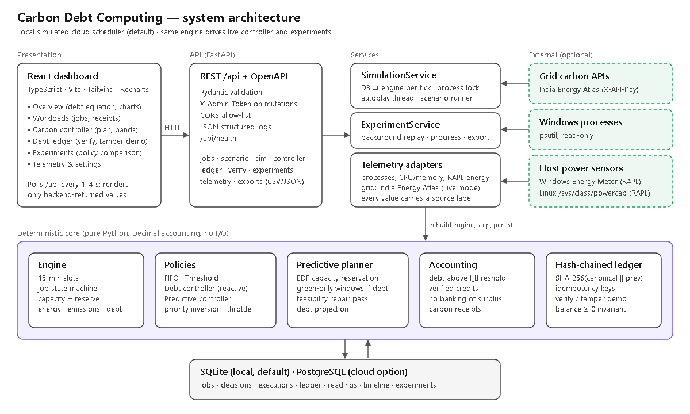
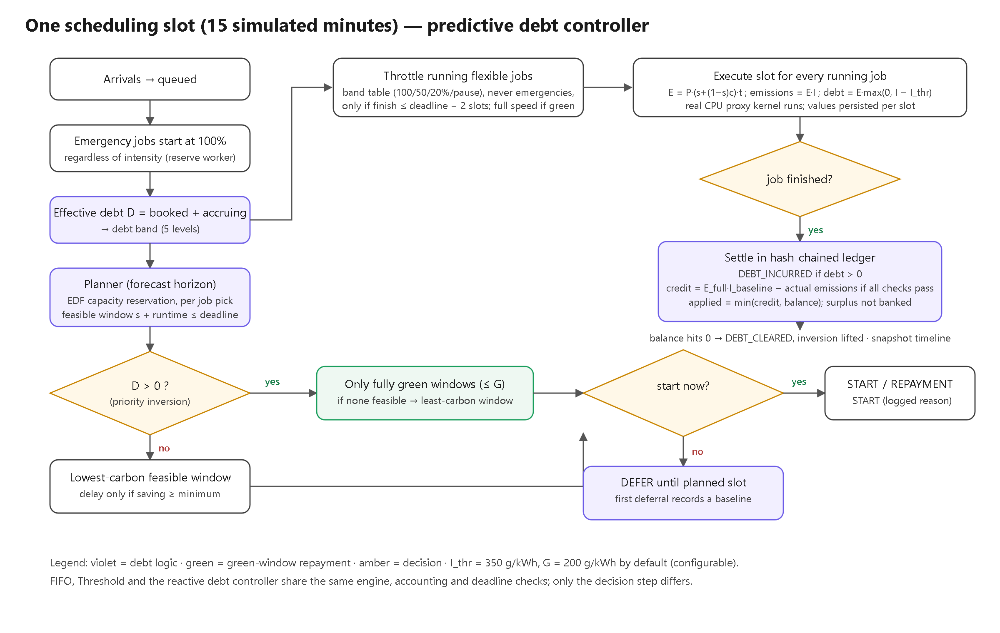
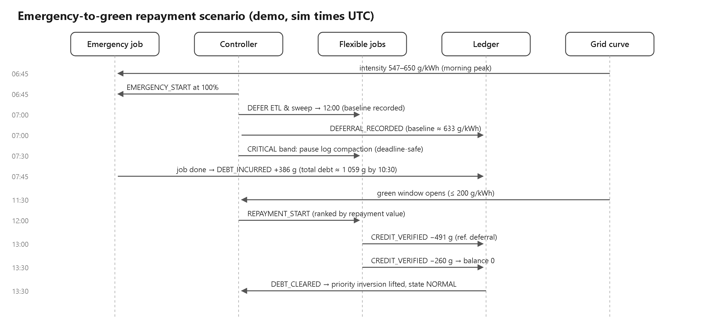
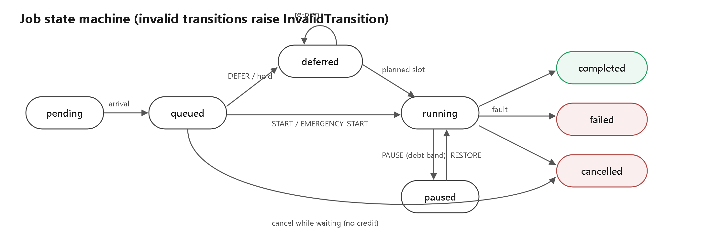

# Architecture



## Components

| Layer | Component | Responsibility |
|---|---|---|
| Presentation | React dashboard (`frontend/src`) | Six pages: Overview, Workloads, Carbon controller, Debt ledger, Experiments, Telemetry & settings. Polls the API (every 1 s while playing, 3–4 s otherwise) and displays only backend-returned values. |
| API | FastAPI (`backend/app/main.py`, `api/routes.py`) | REST + OpenAPI, Pydantic validation, `X-Admin-Token` on mutations, CORS allow-list, JSON structured logs, health check. |
| Service | `SimulationService` | For each tick: rebuild the engine from the DB, step it, and persist every new decision, execution attempt, ledger record, carbon reading and timeline point in **one transaction**. A process-wide lock serialises all mutations, so the hash chain cannot fork. Also runs the autoplay thread and the scenario. |
| Service | `ExperimentService` | Runs experiments in a background thread, one at a time, persists progress and results, exports CSV/JSON. |
| Service | `LiveService` + telemetry | Live mode (`live.py`): real-time 30-second slots, bounded CPU workers, measured energy. `india_energy_atlas.py` (grid intensity), `system_monitor.py` (Windows processes, CPU/memory, Energy Meter / RAPL), `modes.py` (Simulation ⇄ Live; separate databases). |
| Core | `engine.py` | Slot loop, job state machine, capacity model, energy/emissions/debt per slot, settlement. |
| Core | `policies.py`, `planner.py` | FIFO, threshold, reactive debt controller, predictive controller; throttle bands; reservation planner and debt projection. |
| Core | `accounting.py`, `ledger.py`, `hashchain.py` | Formulas, credit eligibility, balance-carrying idempotent ledger, SHA-256 chain verification. |
| Core | `carbon_curve.py`, `workloads.py`, `experiment.py`, `metrics.py` | Deterministic curves, demo jobs and seeded traces, replay runner, metrics. |
| Persistence | SQLAlchemy models (`models.py`) | SQLite by default; PostgreSQL via `DATABASE_URL`. Decimal values are stored as exact strings (`DecimalString`), so hashes round-trip bit for bit. |

### Why one engine for everything

Live mode and experiments call the same `Engine.step()`. An experiment result is therefore literally what the dashboard would have shown for that trace. Nothing in the frontend computes carbon numbers.

### Database tables

`sim_clock` (single row: simulated clock, autoplay, controller state) · `settings` (controller configuration JSON, last plan) · `jobs` · `decisions` · `execution_attempts` (one row per job per slot, including the real proxy-kernel CPU time) · `ledger_entries` (hash chain) · `carbon_readings` · `timeline_points` · `experiment_runs`. The live database (`carbon_debt_live.db`) has the same tables plus `grid_readings` (every real India Energy Atlas reading and forecast point).

## Data flow for one tick

1. The autoplay thread (or `POST /api/sim/advance`) calls `SimulationService.tick()`.
2. Under the lock: load the config, the carbon curve, every job and the ledger tail (`seq`, `last_hash`, `balance`, idempotency keys).
3. `Engine.step()` runs the policy decision, executes one slot (including the real SHA-256 proxy kernel, `KERNEL_MS × capacity` per job), and settles finished jobs into the ledger.
4. All new rows are inserted and the clock advances. The transaction commits; on any error it rolls back.
5. The frontend's next poll shows the change.

## Scheduling flow



## Scenario sequence



## Job state transitions



## REST API

| Method | Path | Purpose |
|---|---|---|
| GET | `/api/health` | liveness, database status, whether an admin token is required |
| GET | `/api/state` | dashboard state: clock, intensity, ledger totals, job counts, controller state, recent decisions |
| POST | `/api/sim/advance` `{slots}` | advance the simulation 1–96 slots |
| POST | `/api/sim/autoplay` `{enabled, speed_ms}` | backend-driven play/pause |
| POST | `/api/scenario/run` `{mode: animated\|instant}` | **Emergency-to-green repayment scenario** (resets demo data) |
| GET | `/api/scenario/status` | the 7 milestones, detected from persisted records |
| POST | `/api/demo/load` · `/api/demo/reset {confirm:"RESET"}` | demo data management |
| GET/POST | `/api/jobs` | list (filters `state`, `job_class`, `q`) / create (validated, idempotent) |
| GET | `/api/jobs/{id}` · `/api/jobs/{id}/receipt` | detail with decisions, execution attempts and ledger events · carbon receipt |
| POST | `/api/jobs/{id}/actions` `{action: run\|defer\|cancel}` | operator actions (invalid transitions → 409) |
| GET | `/api/decisions` | decision log |
| GET | `/api/carbon/curve` · `/api/timeline` · `/api/gantt` | chart data |
| GET / PUT | `/api/controller` · `/api/controller/settings` | plan, projection, bands, repayment queue / validated settings changes |
| GET | `/api/ledger` · `/api/ledger/verify[?expected_head=]` · `/api/ledger/export.csv` | ledger, verification, export |
| POST | `/api/ledger/tamper-demo` | modify an in-memory copy and show detection |
| GET | `/api/stats/workloads` | per-workload debt statistics |
| POST/GET/DELETE | `/api/experiments[/{id}]`, `/export.csv`, `/report.json`, `/defaults` | experiments |
| GET | `/api/telemetry/status` · `/api/telemetry/host` · `/api/telemetry/carbon-live` | sources, host power, live grid reading |
| GET/PUT | `/api/mode` `{mode: simulation\|live}` | read or switch the operating mode (each mode has its own database) |
| POST | `/api/live/monitoring` `{enabled}` | start or stop Live monitoring (processes, grid feed, managed workloads) |
| GET | `/api/live/status` | process table, CPU/memory, energy meter, grid feed status, managed workloads |
| POST | `/api/live/grid/refresh` | fetch the grid reading now (rate-limited to once a minute) |

Errors use a consistent `{"detail": ...}` body: 404 (unknown), 409 (conflict, e.g. invalid state transition), 422 (validation), 401 (missing admin token), 502 (provider failure).

## Deployment architecture

```
Local (default)                         Cloud VM (recommended option)
┌──────────────┐  /api proxy  ┌───────┐  Internet ─HTTPS─▶ Caddy (TLS, :443)
│ Vite :5173   │─────────────▶│uvicorn│                       │
└──────────────┘              │ :8000 │                       ▼
                              └──┬────┘             nginx (frontend, /api proxy)
                                 │                            │
                              SQLite file                     ▼
                                                    backend container ─▶ SQLite on named volume
```

The details, plus a Render (PaaS + PostgreSQL) alternative, are in [CLOUD_DEPLOYMENT.md](CLOUD_DEPLOYMENT.md). In every deployment, the *workloads* are simulated by the scheduler. Deploying the dashboard to a cloud VM does not create a real cloud cluster.
