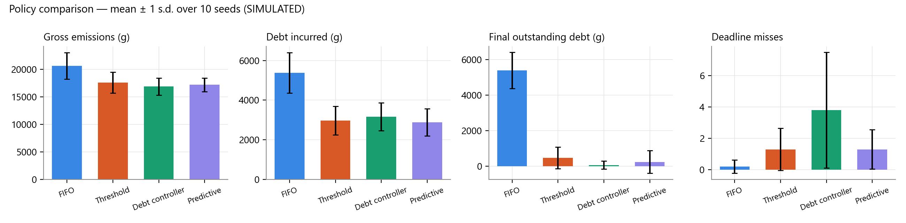
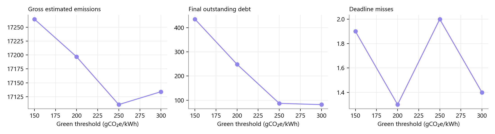

# Experiments

## Question

Does a carbon-debt controller reduce policy-defined debt and emissions compared with ordinary and threshold-based scheduling, and what does it cost in delay and deadline misses? Does forecasting help?

## Policies compared

1. **FIFO / priority:** carbon-unaware baseline.
2. **Threshold:** defer flexible work while intensity > 350 gCO₂e/kWh.
3. **Debt controller (reactive):** priority inversion to green slots while debt > 0, plus throttling. No forecast.
4. **Predictive debt controller:** the above plus the capacity-aware forecast planner, debt projection and proactive throttling.

## Workload traces

For each seed, `generate_trace(TraceSpec(seed))` produces **36 jobs** with arrivals between 00:00 and 22:00:

| Class | Count | Runtime | Power | Deadline slack |
|---|---|---|---|---|
| Emergency | 4 | 30–90 min | 0.8–2.0 kW | runtime + 30 min |
| Normal | 18 | 15–120 min | 0.3–1.2 kW | 1–10 h |
| Background | 14 | 60–240 min | 0.4–1.5 kW | 8–24 h (max wait 20 h) |

The carbon curve is `solar_midday` with the same seed and 3% noise. Configuration: 4 workers, 1 reserved for emergencies, `I_threshold` = 350, green ≤ 200, bands 100 / 400 / 800 g, static power share 0.3.

**Fairness.** For each seed, every policy receives a fresh copy of the *identical* trace and curve, and the same energy model, accounting and capacity. Runs end when all jobs are settled, or at 72 h.

## Metrics

Gross estimated emissions · total energy · debt incurred · credits applied and earned · final and peak outstanding debt · deadline misses (all and emergency) · average waiting time (arrival → start) · average completion delay (finish − arrival − runtime) · deferral decisions and jobs deferred · throttle/pause actions · energy per completed job · measured decision time per slot.

## Results (10 seeds, mean ± sample s.d.)

Source: `docs/results/experiment_results.json` and `experiment_runs.csv`. Regenerate with `backend\.venv\Scripts\python tools\generate_results.py`.

| Metric | FIFO | Threshold | Debt controller | Predictive |
|---|---|---|---|---|
| Gross emissions (g) | 20,637 ± 2,415 | 17,588 ± 1,920 | **16,880** ± 1,542 | 17,197 ± 1,230 |
| vs FIFO | — | −14.8% | −18.2% | −16.7% |
| Debt incurred (g) | 5,385 | 2,965 | 3,160 | **2,880** |
| Credits applied (g) | 0 | 2,496 | 3,088 | 2,632 |
| Final outstanding debt (g) | 5,385 | 469 | **72** | 248 |
| Peak outstanding debt (g) | 5,385 | **1,609** | 1,639 | 1,697 |
| Deadline misses per run | **0.2** | 1.3 | 3.8 | 1.3 |
| Avg completion delay (min) | **24** | 236 | 422 | 408 |
| Energy (kWh) | 49.8 | 49.8 | 50.2 | 51.3 |
| Throttle/pause actions | 0 | 0 | 3.5 | 13.6 |
| Decision time per slot | ≈ 0.01 ms | ≈ 0.05 ms | ≈ 0.12 ms | ≈ 0.8 ms |



### Demo scenario (8 hand-written jobs, 06:00–16:00)

| Policy | Gross emissions | Debt incurred | Final debt | Deadline misses |
|---|---|---|---|---|
| FIFO | 4,742 g | 1,980 g | 1,980 g | 0 |
| Threshold | 3,444 g | 1,047 g | 0 g | 0 |
| Debt controller | 3,187 g | 1,064 g | 0 g | 0 |
| **Predictive** | **3,122 g (−34.2%)** | 1,059 g | **0 g** (cleared 13:30) | 0 |

### Sweep: green threshold (predictive controller, 10 seeds)

| Green threshold (g/kWh) | 150 | 200 | 250 | 300 |
|---|---|---|---|---|
| Gross emissions (g) | 17,264 | 17,197 | 17,111 | 17,134 |
| Final debt (g) | 435 | 248 | 87 | 82 |
| Deadline misses | 1.9 | 1.3 | 2.0 | 1.4 |



## Interpretation

- **All carbon-aware policies cut emissions by 15–18%** compared with FIFO, at the cost of hours of delay for flexible work. That trade-off is intrinsic: work is moved into the midday solar trough.
- **The predictive controller incurs the least debt** (−46.5% vs FIFO) and has the **lowest variance in emissions**. It keeps deadline misses at the threshold policy's level (1.3 per run).
- **The reactive debt controller without a forecast** reaches slightly lower emissions and final debt, but misses **~3× more deadlines** (3.8). Without a forecast it defers slot by slot. Under debt, many jobs wait for a green slot that may not come before their deadlines, then all start at their last feasible moment and collide for capacity (the "last-moment herd"). The forecast planner reserves capacity in advance, earliest deadline first, which avoids this.
- **The predictive controller leaves more final debt (248 g) than the reactive one (72 g)** because it protects deadlines. When no green window fits before a deadline, it runs the job in the least-carbon feasible window instead of waiting. It also throttles more (13.6 actions), which costs 3% extra energy because of static power.
- **Peak debt is similar across the carbon-aware policies.** Peaks come from emergencies, which every policy runs immediately by design.
- **Raising the green threshold** lets more slots count as repayment windows. That lowers final debt (435 → 82 g) with little change in emissions. Lowering it to 150 makes repayment windows scarce.
- **Overhead** is under 1 ms per 15-minute decision, which is negligible.

These numbers come from a simulation with estimated energy and an illustrative curve. They support *relative* conclusions about the policies, not absolute claims about any real data centre. Nothing was tuned to hit a target. During development, an earlier version of the planner had more deadline misses; the cause was diagnosed (greedy capacity reservation, and throttled jobs holding whole workers) and fixed, and the trade-offs that remain are reported as they are.

## Reproducing

```powershell
backend\.venv\Scripts\python tools\generate_results.py      # writes docs/results/*
```

Or use the Experiments page: choose seeds, policies, the trace mix, thresholds and an optional sweep, then **Run experiment**, and export CSV or the JSON report. `tests/test_experiments.py` asserts that replay is deterministic.
